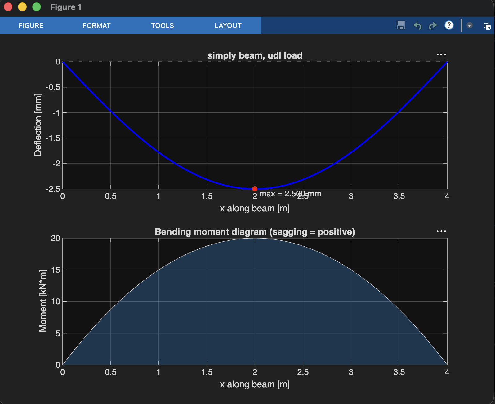

# Beam Deflection Calculator (MATLAB)

Takes a beam's length, material, cross-section, and load, then calculates the maximum deflection and bending stress and plots the deflected shape and bending moment diagram.

## Method

The beam is modeled with Euler-Bernoulli theory (linear elastic, small deflections), where the moment-curvature relationship is

$$EI\,\frac{d^2y}{dx^2} = M(x)$$

where $E$ is Young's modulus, $I$ is the second moment of area of the cross-section, $M$ is the bending moment (sagging positive), and $y$ is the deflection (positive up).

**Deflection** comes from the closed-form elastic curves in the standard beam deflection tables. Max deflection for the four supported cases (with $\delta$ taken as a magnitude, load acting downward):

| Support | Load | $\delta_{max}$ | Location |
|---|---|---|---|
| Simply supported | Point load $P$ at midspan | $\dfrac{PL^3}{48EI}$ | $x = L/2$ |
| Simply supported | Uniform load $w$ | $\dfrac{5wL^4}{384EI}$ | $x = L/2$ |
| Cantilever | Point load $P$ at free end | $\dfrac{PL^3}{3EI}$ | $x = L$ |
| Cantilever | Uniform load $w$ | $\dfrac{wL^4}{8EI}$ | $x = L$ |

**Bending stress** uses the flexure formula:

$$\sigma_{max} = \frac{M_{max}\,c}{I}$$

**Section properties** (second moment of area $I$):

- Rectangle: $I = \dfrac{bh^3}{12}$
- Circle: $I = \dfrac{\pi D^4}{64}$
- Hollow sections and I-beams: outer shape minus the cut-out, e.g. $I = \dfrac{bh^3 - b_ih_i^3}{12}$

**Numerical cross-check.** As a second, independent method, the script also integrates $M/EI$ twice with the trapezoid rule (`cumtrapz`) and applies the boundary conditions ($y(0)=y(L)=0$ for simply supported, $y(0)=y'(0)=0$ for cantilever).

**Sources**
- Gere & Goodno, *Mechanics of Materials*, Appendix G (deflections and slopes of beams) and the flexure formula chapter
- Hibbeler, *Mechanics of Materials*, Appendix C (slopes and deflections of beams)

## Sample input and output

Input (top of `beam_deflection.m`):

```matlab
L        = 4;            % m
support  = 'simply';
loadType = 'udl';
loadMag  = 10e3;         % N/m
material = 'steel';
sectionType = 'rect';
dims = [0.10 0.20];      % b = 100 mm, h = 200 mm
```

Output:

```
---------- BEAM DEFLECTION RESULTS ----------
Support / load    : simply / udl
Length            : 4.000 m
Load              : 1e+04 (N or N/m)
E                 : 200 GPa
I                 : 6.6667e-05 m^4
Max deflection    : 2.5000 mm at x = 2.000 m
Max moment        : 2e+04 N*m
Max bending stress: 30.000 MPa
Span / deflection : L/1600
----------------------------------------------
```

## Validation

**Matches hand calculation within 0.0002% error.**

Four cases were worked by hand from the table formulas (steel, 0.10 m x 0.20 m rectangle, so $EI = 13.333 \times 10^6$ N·m²) and compared against the script:

| Case | Hand (mm) | Script (mm) | Error | Numerical integration error |
|---|---|---|---|---|
| Simply supported, $w$ = 10 kN/m, $L$ = 4 m | 2.500 | 2.500 | 0.0000% | 0.0002% |
| Simply supported, $P$ = 20 kN, $L$ = 4 m | 2.000 | 2.000 | 0.0000% | 0.0001% |
| Cantilever, $P$ = 5 kN, $L$ = 2 m | 1.000 | 1.000 | 0.0000% | 0.00003% |
| Cantilever, $w$ = 2 kN/m, $L$ = 2 m | 0.300 | 0.300 | 0.0000% | 0.0000% |

The table-formula column agrees essentially exactly because the script uses those same formulas, so the numerical integration column is the more meaningful check. It uses a different method and still agrees to about 0.0002%. The table prints automatically when you run the script (`doValidation = true`).

## Plot



## How to run

1. Put `beam_deflection.m` in a folder and open it in MATLAB (R2016b or newer).
2. Edit the inputs in section 1 at the top of the file.
3. Press **Run** (or type `beam_deflection` in the Command Window).

The results print in the Command Window, the figure opens, and `deflection_plot.png` is saved to the current folder. Set `doValidation = false` to skip the validation table.

**Limitations:** SI units only, one load per beam, and only the four cases above. Adding other loads (off-center point load, overhanging beams) means adding a case to `momentCurve` and `deflectionCurve`.
